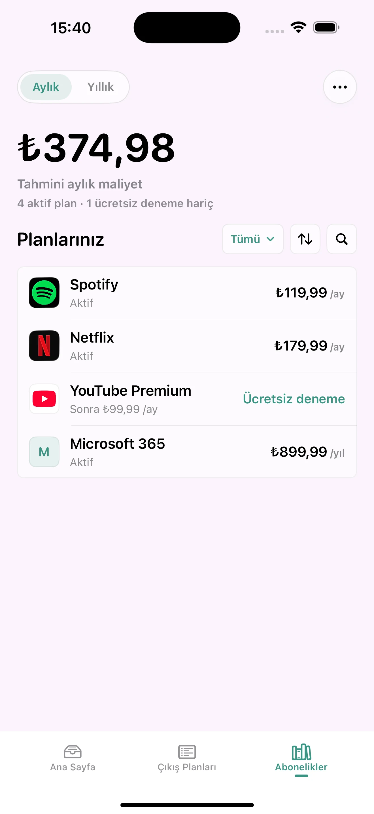

# RenewExit

A free, privacy-first iPhone app for manually tracking subscriptions and free trials.

**[Download on the App Store](https://apps.apple.com/tr/app/renewexit/id6783497676?l=tr)**

**Source code is currently private.** This repository is a public product showcase.

  

## Why RenewExit

Subscriptions and free trials come with renewal dates and cancellation steps that are easy to lose track of. RenewExit brings those details together so users can understand what is coming up and plan their next action.

## Key features

- Manually track subscriptions and free trials.
- Review upcoming renewals and estimated subscription costs.
- Set local reminders for dates that matter.
- Use Exit Plans to organize cancellation paths and next steps.

## Privacy by design

- Local-first storage for the subscription and trial records you enter.
- No account required.
- No bank access or email scanning.
- No automatic subscription detection.
- Local reminders, under your control.

## Product decisions and tradeoffs

- **Manual tracking:** avoids requiring access to financial accounts or email. Users are responsible for entering and keeping their records up to date.
- **Clear cancellation boundaries:** RenewExit supports planning; it does not automatically cancel subscriptions. Users complete cancellation with the relevant provider.
- **Completely free:** the product is available without a paid tier.
- **Renewal and exit planning:** upcoming dates and Exit Plans help users understand both when a plan renews and how to leave it.

## Built with

Swift, SwiftUI, and SwiftData.

## Availability

RenewExit is available for iPhone and is completely free.

[View RenewExit on the App Store](https://apps.apple.com/tr/app/renewexit/id6783497676?l=tr).

## Source availability

Production source code is currently private. This repository contains only this README and an approved product screenshot; it does not include application source code or build files.
